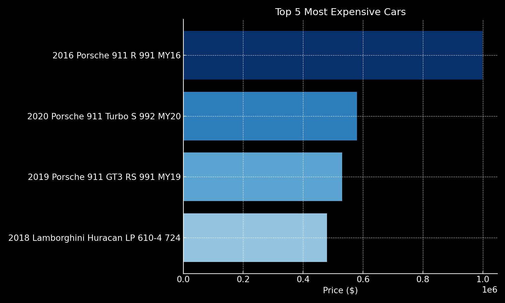
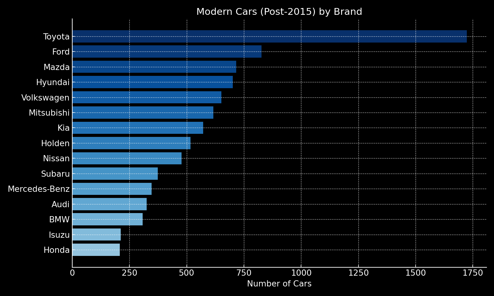
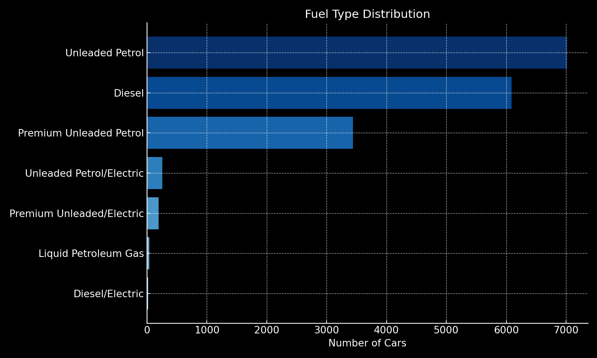
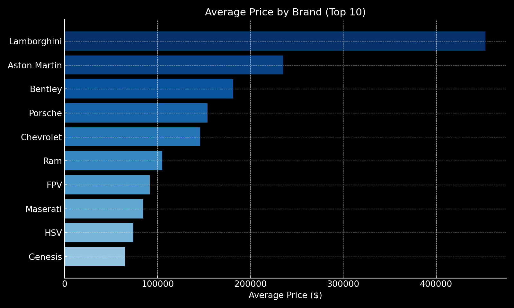
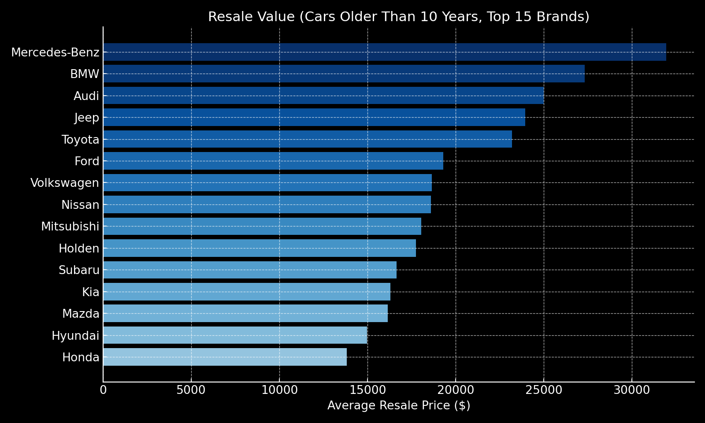
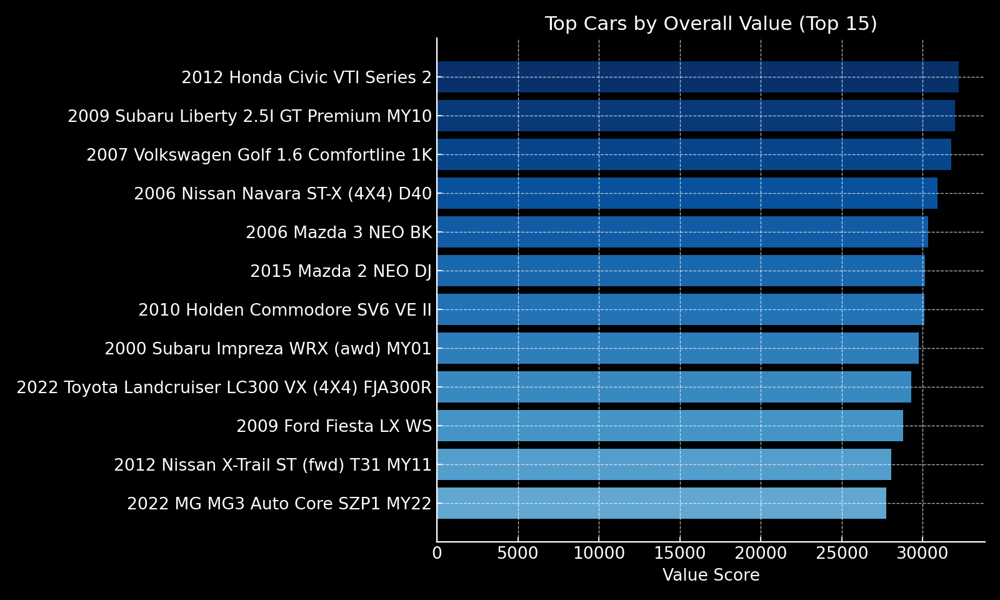

  

# Australian Car Listings Analysis with SQL

A MySQL learning project exploring prices, vehicle characteristics, and listing composition in an Australian car dataset. The analysis uses filtering, aggregation, common table expressions, and ranking to investigate questions relevant to buyers and dealerships.

## Business questions

- Which listings have the highest advertised prices?
- Which brands have the most listings for vehicles manufactured after 2015?
- How are fuel types distributed within the dataset?
- How do average advertised prices differ by brand?
- Which brands have the highest average asking prices among older vehicles?
- How might price, model year, and mileage inform a shortlist for further investigation?

These are exploratory questions about the available listings. They do not establish national sales, market demand, depreciation, or an individual vehicle's quality.

## Data and tools

- **Dataset:** [Australia Car Market Data on Kaggle](https://www.kaggle.com/datasets/lainguyn123/australia-car-market-data/data)
- **Fields used:** brand, model/name, model year, kilometres, price, vehicle type, fuel, and engine size.
- **Tools:** MySQL, Visual Studio Code, Git, and GitHub.
- **Files:** [SQL queries](Queries), [dataset directory](Dataset), and [visualizations](Assets).

## Analysis walkthrough

### 1. Highest-priced listings

This view ranks the highest advertised prices in the dataset. A small group of expensive listings is useful for identifying outliers and inspecting the premium end of the sample. It does not establish which brands dominate the wider premium market or what buyers actually paid.

### 2. Vehicles manufactured after 2015, by brand

The [query](Queries/2_how_many_modern_cars_after_2015.sql) counts listings with a model year greater than 2015. This describes sample availability, not inventory turnover, fuel efficiency, or dealership sales performance. "After 2015" is a fixed model-year filter, not a rolling definition of a modern vehicle.

### 3. Fuel type distribution

The [query](Queries/3_fuel_type_distribution.sql) calculates each fuel type's share of the dataset's listings. This can inform further investigation of the sample's composition. A single listing snapshot cannot establish national EV adoption, growth over time, or how Australia compares with other countries.

### 4. Average advertised price by brand

The [query](Queries/4_avg_price_of_cars_bybrand.sql) returns the ten highest brand-level average prices and their listing counts. Differences can reflect the mix of models, ages, mileage, and outliers. They do not independently measure brand equity or consumer trust. Median prices and comparable vehicle groups would provide useful checks.

### 5. Average asking price among older vehicles

The [existing query](Queries/9_brand_with_highest_resale_value.sql) groups vehicles whose model year is at least ten years before the current calendar year, retaining brands with more than 100 eligible listings.

The query and chart use "resale value" terminology, but the measured quantity is **average advertised price among eligible older vehicles**. It is not a measure of value retention: original purchase prices, completed sale prices, and comparable age, model, mileage, and condition are needed to assess depreciation fairly.

The query uses `CURDATE()`, so the eligible model years change as time passes even if the dataset stays the same. An explicit analysis date is needed to reproduce an earlier result. The model-year cutoff also does not establish each vehicle's exact age.

### 6. Experimental vehicle shortlist

The [existing scoring query](Queries/12_top_cars_by_overall_value.sql) combines differences from the dataset averages for model year, price, and kilometres, with weights of 0.4, 0.4, and 0.2.

**Method limitation:** the inputs use different units and scales. Those weights do not represent 40%, 40%, and 20% relative influence; dollar and kilometre magnitudes can overwhelm model-year differences. The resulting ranking is an experimental calculation, not a validated "best value" recommendation.

A stronger method would normalize the inputs, justify buyer priorities, handle missing or implausible values, and test how rankings change under alternative weights. Condition, service history, and ownership costs would still require separate assessment.

## Interpretation and validation status

The charts are existing project artifacts. They have not been regenerated as part of this documentation update; this README does not assert fresh numerical results or claim that existing charts have been reconciled with a new query run.

Before using the analysis for a decision:

1. Record the dataset version, collection period, license, and analysis date.
2. Validate missing values, duplicate listings, price units, and implausible price or mileage records.
3. Re-run the queries and save their outputs alongside the charts.
4. Check counts and medians before interpreting brand-level averages.
5. Distinguish advertised prices from sale prices and sample composition from market-wide conclusions.

## Relevance to business analysis

The project illustrates how to translate questions into measurable SQL outputs and evaluate whether a metric supports a proposed conclusion. Its current scope is a learning exercise. Recommendations for actual purchasing or inventory decisions would require validated data, explicit stakeholder priorities, and additional evidence.

## Next improvements

- Replace the moving older-vehicle cutoff with a documented reference date.
- Redesign and validate the experimental value score.
- Add repeatable import instructions, query outputs, and chart-generation steps.
- Present findings with sample sizes, limitations, and clearly stated decision implications.
